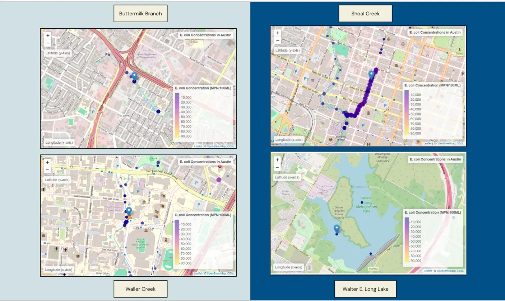

# Weather and E. coli in Austin creeks: spatiotemporal modeling (UT Austin capstone)

City of Austin water-quality samples, joined to hourly weather, for creeks and lakes in Austin. The scripts are a UT Austin capstone: exploratory maps and seasonal plots in R, then classification and regression notebooks in Python.

## TL;DR

- The modeling table has **3,832 weather-enriched observations and 20 columns** (`data/processed/ECOLI_W_API.csv`), from samples dated 3 January 2013 through 5 February 2025.
- Notebooks compare **logistic regression**, **k-nearest neighbors**, and **XGBoost**. Logistic regression is the generalized linear model in this repo, and XGBoost is the gradient-boosting model. Separate notebooks fit linear regression, Huber regression, and a neural net to the concentration itself.
- Metrics computed in those notebooks are **F1, accuracy, ROC-AUC, Brier score, expected calibration error, MSE, R², and confusion matrices**. The confusion matrices are the false-positive check. Re-run the notebooks before citing a score. Treat the outputs already stored in the `.ipynb` files as a previous run.

## Map

Sampling locations for four watersheds. Marker color is E. coli concentration (MPN/100 mL). The interactive version is built in `src/exploratory_analysis/Geographical_Visualization.Rmd`; this still is the copy saved with the project report. Basemap © OpenStreetMap contributors.



## Data

Water-quality samples are the City of Austin open-data set [Water Quality Sampling Data](https://data.austintexas.gov/d/5tye-7ray) (public domain), exported from the City's Water Resources Monitoring database. This repo uses the E. coli extract from that set.

The **2 TB figure is the size of that source database, not the number of training rows.** The export was prepared with SQL and pandas. The scripts in this repo start from the CSV: 3,837 rows in `data/raw/ECOLI_BACTERIA_2013-PRESENT.csv`, then 3,832 after rows missing a date, time, or coordinate were dropped. Weather fields (temperature, humidity, precipitation, and the other columns in the enriched file) were joined from the [Visual Crossing Timeline API](https://www.visualcrossing.com/weather-api) using each sample's latitude, longitude, and time.

| File | What it is |
| --- | --- |
| `data/raw/ECOLI_BACTERIA_2013-PRESENT.csv` | E. coli export, 3,837 × 23 |
| `data/raw/ECOLI_BATCTERIA_2013-PRESENT_20250228.xlsx` | Same extract as a workbook. The filename keeps the original spelling. |
| `data/processed/ECOLI_CLEAN.csv` | Columns kept by `Data_Wrangling.R` (3,837 rows) |
| `data/processed/ECOLI_W_API.csv` | Weather-enriched modeling table, 3,832 × 20 |
| `data/processed/ECOLI_W_API.xlsx` | Workbook of the enriched table (3,832 data rows) |
| `data/processed/ECOLI_CLEAN.xlsx` | Cleaned rows as a spreadsheet, saved without a header row |

## Repository

```
src/data_preprocessing/     Data_Wrangling.R, API_Wrangling.Rmd
src/exploratory_analysis/   Time_Series_Analysis.R, Geographical_Visualization.Rmd, E_Coli_VS_Temp.R
src/modeling/               classification and regression notebooks
data/raw/                   City of Austin E. coli export
data/processed/             cleaned table and weather-enriched table
reports/Research_Paper_Final.pdf
reports/Exploratory_Analysis_Presentation.pdf
reports/figures/            map above
reports/Concentration v.s. Humidity.docx
docs/methods.md             preprocessing and model notes
docs/limitations.md
docs/findings.md            exploratory notes; model scores are not restated there
environment.yml             R environment
requirements.txt            Python packages
```

## Reproduce

Run commands from the repository root.

Python:

```bash
python -m venv .venv
source .venv/bin/activate
pip install -r requirements.txt
```

R packages used by the scripts are listed in `environment.yml` (`conda env create -f environment.yml`, then `conda activate ecoli-analysis`). The map and hex-bin scripts also need `ggmap`, `sf`, `osmdata`, `viridis`, and `hexbin`.

Order:

1. `Rscript src/data_preprocessing/Data_Wrangling.R` writes `data/processed/ECOLI_CLEAN.csv`. That file is already in the repo, so this step is optional.
2. `src/data_preprocessing/API_Wrangling.Rmd` re-downloads weather for every row. It will not run until `API_KEY_HERE` is replaced with a Visual Crossing key. Skip it and use the saved `data/processed/ECOLI_W_API.csv`.
3. Exploratory scripts, still from the repo root: `Rscript src/exploratory_analysis/Time_Series_Analysis.R`, then `Rscript src/exploratory_analysis/E_Coli_VS_Temp.R`. Knit `src/exploratory_analysis/Geographical_Visualization.Rmd` for the interactive map.
4. Notebooks, from the repo root or from `src/modeling/` (both resolve the CSV):
   - `src/modeling/Modeling_Final_With_Validation.ipynb` (logistic regression, KNN, XGBoost)
   - `src/modeling/Model_Accuracy__MSE_and_F1_score_.ipynb` (same classifiers, plus linear, Huber, and a neural net). Skip the Colab upload cell; the next cell reads the CSV.
   - `src/modeling/Regression_Model.ipynb`
   - `src/modeling/Regression_Model_W_LogscalePreprocessing.ipynb`
   - `src/modeling/Importance_Scores.ipynb`

`Importance_Scores.ipynb` scales the training matrix to an array and a later cell still reads `.columns` from that array, so that feature-importance cell fails as written.

## Limitations

- **Preprocessing order.** In the classification notebooks, mean imputation and the correlation filter run on the full table before the train/test split. Whether that leaks into the scores has not been re-checked.
- **Class balance depends on the cutoff.** The notebooks mark a sample unsafe at 100 MPN/100 mL, which is 1,934 of 3,832 rows. A high-event cutoff above 3,000 MPN/100 mL leaves 56 positive rows.
- **Site-level confounders.** Notebook features are weather fields only, while most rows are streams (3,392 of 3,832) spread across 62 watersheds. Watershed and site type can still drive the concentration.
- Sampling effort is uneven across watersheds and seasons. Land use, pollution sources, and flow are not in the table. `docs/methods.md` records that 5 of the 3,832 weather requests failed on the original pull.

Code in this repository is under the MIT license. The City of Austin sampling table is public domain. Weather values were retrieved from the Visual Crossing Timeline API.
